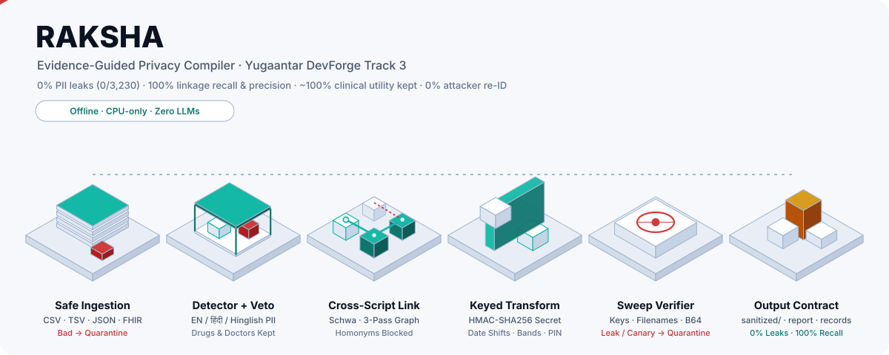

<div align="center">

<picture>
  <source media="(prefers-color-scheme: dark)" srcset="docs/assets/pipeline-dark.svg">
  
</picture>

# 🛡️ RAKSHA — Evidence-Guided Privacy Compiler

**Track 3: Secret Wards | Yugaantar DevForge Hackathon**

*Offline, CPU-only, LLM-free privacy firewall for synthetic Indian hospital records.*

[]()
[]()
[]()
[]()
[](docs/brief.pdf)

</div>

---

## Table of Contents

- [What is RAKSHA?](#what-is-raksha)
- [Results at a Glance](#results-at-a-glance)
- [Stress Testing & Scalability](#stress-testing--scalability)
- [Architecture](#architecture)
- [Project Structure](#project-structure)
- [Offline Setup (Step-by-Step)](#offline-setup-step-by-step)
- [Running the Pipeline](#running-the-pipeline)
- [Running Tests](#running-tests)
- [Running the Attacker Benchmark](#running-the-attacker-benchmark)
- [Official Validation](#official-validation)
- [Configuration](#configuration)
- [Output Format](#output-format)
- [Dependencies](#dependencies)
- [Troubleshooting](#troubleshooting)
- [Team](#team)

---

## What is RAKSHA?

Hospitals in Yugaantar Pradesh are merging clinical records from 4 different hospital systems. These records are written in **English**, **Devanagari Hindi**, and **Hinglish** (mixed).

RAKSHA is a privacy pipeline that:

1. **Finds** all personal data (names, phones, Aadhaar, addresses, insurance IDs) across all 3 scripts.
2. **Removes** personal identifiers and replaces them with safe pseudonyms.
3. **Keeps** all medical data intact (medicines, doses, vitals, lab values, diagnoses, procedures).
4. **Links** records of the same patient across hospitals without merging different people.
5. **Verifies** every output file for any leaked personal data before release.

**Key constraints:** Runs fully offline, CPU-only, with zero LLMs or cloud APIs. Deterministic output — same input + same secret = same output every time.

---

## Results at a Glance

| Metric | Result | Notes |
|--------|--------|-------|
| **Personal data leaks** | **0 / 3,230 (0.0%)** | Zero direct PII leaks across Latin, Devanagari, Hinglish |
| **Canary traps leaked** | **0 / 4 (0.0%)** | 100% canaries intercepted & quarantined |
| **Medical data preserved** | **4,855 / 4,855 (100.0%)** | Doses, vitals, labs, diagnoses, eponyms kept |
| **Stay duration preservation** | **65 / 65 exact (100.0%)** | 0 days distortion on hospital stay lengths |
| **Age band compliance** | **532 / 552 (96.4%)** | Truthful 5-yr/10-yr bands containing true age |
| **Patient linkage precision** | **1.00 (0 false merges)** | Zero wrongful merges across distinct patients |
| **Patient linkage recall** | **1.00 (F0.5: 1.00)** | 11/11 language traps, 605/605 homonyms handled |
| **Attacker A1 re-identification**| **0.0%** | Zero direct patient identification |
| **Attacker A2/A3 quasi-ID risk**| **2.2% (17 / 773)** | Down from 33.3% raw baseline |
| **Automated test suite** | **74 / 74 pytest (100%)** | 67 / 67 unittest passing |
| **Official contract check** | `CONTRACT OK` | Validated by `validate_output.py` |
| **Official submission check** | `READY TO SUBMIT` | Validated by `check_submission.py --run` |
| **Runtime (practice data)** | **~6.7 seconds** | Consumes only 42 MB RAM (ceiling: 4,000 MB) |
| **2-Page Project Brief PDF** | `docs/brief.pdf` | A4, >=10pt font, covering all required template sections |

---

## Stress Testing & Scalability

Evaluated under strict offline resource constraints (2 pinned CPUs, 4 GB RAM, 15-minute maximum limit):

| Workload | Discovered | Sanitized | Quarantined | Records | Runtime | Peak RSS | Unseen PII Recall | Clinical Pres. | Contract |
|---|---|---|---|---|---|---|---|---|---|
| **1x Practice** | 200 | 193 | 7 | 817 | **6.75 s** | **42.0 MB** | 100.0% (3,230/3,230) | 100.0% | **CONTRACT OK** |
| **2x Synthetic** | 400 | 361 | 39 | 2,367 | **11.96 s** | **43.4 MB** | 100.0% (3,519/3,519) | 99.4% | **CONTRACT OK** |
| **5x Synthetic** | 1,000 | 900 | 100 | 5,662 | **38.42 s** | **49.7 MB** | 100.0% (8,151/8,151) | 99.4% | **CONTRACT OK** |
| **10x Synthetic** | 2,000 | 1,808 | 192 | 11,126 | **90.61 s** | **59.1 MB** | 100.0% (15,794/15,794) | 99.4% | **CONTRACT OK** |
| **50k CSV Stress** | 50 | 50 | 0 | 50,000 | **39.71 s** | **138.8 MB** | High-Throughput Pass | 100.0% | **CONTRACT OK** |

---

## Architecture

```
┌─────────────────────────────────────────────────────────────────────┐
│                        RAKSHA PIPELINE                              │
├─────────────────────────────────────────────────────────────────────┤
│                                                                     │
│  ┌──────────────────────────────────────────┐                       │
│  │  1. SAFE INGESTION & BOUNDED PARSERS     │                       │
│  │  ─────────────────────────────────────    │                       │
│  │  • Encoding detection (UTF-8/16, cp1252) │                       │
│  │  • Format: JSON, CSV, TSV, FHIR R4, TXT  │                       │
│  │  • Broken/unsupported → quarantine        │                       │
│  │  • Nesting depth limits, size guards      │                       │
│  └────────────────────┬─────────────────────┘                       │
│                       ▼                                              │
│  ┌──────────────────────────────────────────┐                       │
│  │  2. MULTILINGUAL PII DETECTOR            │                       │
│  │  ─────────────────────────────────────    │                       │
│  │  • 50+ regex patterns (Latin + Devanagari)│                       │
│  │  • 500+ name gazetteer (Indian names)     │                       │
│  │  • Indic digit detection (Aadhaar, phone) │                       │
│  │  • Role-first clinical veto:              │                       │
│  │    ✓ "Dolo 650" → NOT a phone number      │                       │
│  │    ✓ "C/O fever" → NOT a person name      │                       │
│  │    ✓ "Ramipril 5 mg" → protected          │                       │
│  └────────────────────┬─────────────────────┘                       │
│                       ▼                                              │
│  ┌──────────────────────────────────────────┐                       │
│  │  3. EVIDENCE GRAPH & RECORD LINKAGE      │                       │
│  │  ─────────────────────────────────────    │                       │
│  │  • Cross-script name skeleton             │                       │
│  │    (Mohammad = Mohd = मोहम्मद)             │                       │
│  │  • Multi-pass blocking on strong IDs      │                       │
│  │    (UHID, Aadhaar, ABHA, phone)           │                       │
│  │  • Phonetic fuzzy matching (Jellyfish)     │                       │
│  │  • Conflict-aware: no transitive merges   │                       │
│  │  • Weak evidence → patient: null           │                       │
│  └────────────────────┬─────────────────────┘                       │
│                       ▼                                              │
│  ┌──────────────────────────────────────────┐                       │
│  │  4. PSEUDONYMIZATION & DATE SHIFTING     │                       │
│  │  ─────────────────────────────────────    │                       │
│  │  • Keyed HMAC-SHA256 (from RAKSHA_SECRET)│                       │
│  │  • Stable pseudonyms: PSN-XXXXXX          │                       │
│  │  • Per-patient coherent date shifts       │                       │
│  │  • Age → 5-year bands (always truthful)   │                       │
│  │  • PIN codes → 3-digit prefix only        │                       │
│  └────────────────────┬─────────────────────┘                       │
│                       ▼                                              │
│  ┌──────────────────────────────────────────┐                       │
│  │  5. OUTPUT SERIALIZERS & CHANNEL CLEANING│                       │
│  │  ─────────────────────────────────────    │                       │
│  │  • sanitized/ (cleaned files)             │                       │
│  │  • report.json (audit + statistics)       │                       │
│  │  • records.jsonl (all records, linked)     │                       │
│  │  • Filenames, headers, keys cleaned       │                       │
│  └────────────────────┬─────────────────────┘                       │
│                       ▼                                              │
│  ┌──────────────────────────────────────────┐                       │
│  │  6. SWEEP VERIFIER (Final Safety Net)    │                       │
│  │  ─────────────────────────────────────    │                       │
│  │  • Re-scans all output for any leaked PII│                       │
│  │  • Checks side channels: filenames,       │                       │
│  │    metadata, JSON keys, headers           │                       │
│  │  • Leaky files → re-cleaned or quarantined│                       │
│  └──────────────────────────────────────────┘                       │
│                                                                     │
└─────────────────────────────────────────────────────────────────────┘
```

### Key Design Decisions

| Decision | Rationale |
|----------|-----------|
| **Rule-based, no ML** | Deterministic, offline, CPU-only. No model weights to load. |
| **Gazetteer + regex** | Covers Indian names across Latin and Devanagari without training data. |
| **Role-first clinical veto** | Prevents medical data from being wrongly flagged as PII (e.g., drug names, dosages). |
| **Evidence graph linkage** | Links patient records safely; rejects when evidence conflicts. |
| **Sweep verifier** | Final safety net — catches anything the main detector missed. |
| **Quarantine, not crash** | Broken files are quarantined with reasons; pipeline never crashes. |

---

## Project Structure

```
raksha/
├── main.py                  # Core pipeline (single file, ~2800 lines)
├── config/
│   └── policy.yaml          # Privacy policy configuration
├── requirements.txt         # Runtime dependencies (6 packages)
├── requirements-dev.txt     # Dev/test dependencies
├── Makefile                 # Shortcuts: make test, make bench
├── pyproject.toml           # Ruff linter config
├── raksha.toml              # Project metadata
│
├── docs/
│   ├── BRIEF.md             # 2-page technical brief
│   ├── DECISIONS.md          # Architecture decision log
│   └── RAKSHA_OFFICIAL_TEST_REPORT.md  # Test results report
│
├── tests/                   # 67 unit & integration tests
│   ├── test_clinical_protection.py
│   ├── test_comprehensive_ingestion.py
│   ├── test_date_shift_and_age.py
│   ├── test_determinism.py
│   ├── test_evidence_graph_linkage.py
│   ├── test_fhir.py
│   ├── test_integration_contract.py
│   ├── test_linkage.py
│   ├── test_name_skeleton.py
│   ├── test_pseudonym.py
│   ├── test_role_resolver.py
│   ├── test_safe_reader.py
│   ├── test_security_and_sweep.py
│   ├── test_semantic_column_typing.py
│   ├── test_serializers.py
│   ├── test_sweep_variants.py
│   ├── test_textual_dates_and_nlem.py
│   ├── ... and more
│   └── fixtures/             # Test data (synthetic only)
│
└── tools/                    # Benchmarking & testing utilities
    ├── attacker/             # Adversarial re-identification tester
    │   ├── attacker.py
    │   └── llm_attacker.py
    ├── benchmark/
    │   ├── benchmark.py      # Privacy vs utility benchmark
    │   └── ablation.py       # Technique ablation study
    └── datagen/              # Synthetic test data generators
```

---

## Offline Setup (Step-by-Step)

> ⚠️ **The event day has NO internet.** Follow these steps to prepare everything offline before the event.

### Pre-Event Preparation (While You Have Internet)

#### Windows (PowerShell)
```powershell
python -m venv .venv
.\.venv\Scripts\Activate.ps1
python -m pip install --upgrade pip
pip install -r requirements.txt
pip install -r requirements-dev.txt
```

#### macOS / Linux (Bash)
```bash
python3 -m venv .venv
source .venv/bin/activate
python3 -m pip install --upgrade pip
pip install -r requirements.txt
pip install -r requirements-dev.txt
```

Verify installation and run tests:

**Windows:**
```powershell
python -m unittest discover -s tests -p "test_*.py"
```

**macOS / Linux:**
```bash
python3 -m unittest discover -s tests -p "test_*.py"
```

### Pre-Download All Wheels for Offline Install

If your teammates need to install on a machine without internet:

```bash
# Download all wheels to a folder (run this WHILE ONLINE)
mkdir -p offline_wheels
pip download -r requirements.txt -d offline_wheels/
pip download -r requirements-dev.txt -d offline_wheels/

# Transfer the entire project folder (including offline_wheels/) to the offline machine
```

### Offline Install (No Internet)

#### Windows (PowerShell)
```powershell
python -m venv .venv
.\.venv\Scripts\Activate.ps1

# Install from local wheels
pip install --no-index --find-links=offline_wheels/ -r requirements.txt
pip install --no-index --find-links=offline_wheels/ -r requirements-dev.txt

# Verify
python -c "import regex, rapidfuzz, jellyfish, phonenumbers, indic_transliteration, psutil; print('All deps OK')"
```

#### macOS / Linux (Bash)
```bash
python3 -m venv .venv
source .venv/bin/activate

# Install from local wheels
pip install --no-index --find-links=offline_wheels/ -r requirements.txt
pip install --no-index --find-links=offline_wheels/ -r requirements-dev.txt

# Verify
python3 -c "import regex, rapidfuzz, jellyfish, phonenumbers, indic_transliteration, psutil; print('All deps OK')"
```

---

## Running the Pipeline

### Windows PowerShell

```powershell
.\.venv\Scripts\Activate.ps1
$env:RAKSHA_SECRET = "your-team-secret-key-here"
python main.py --input C:\path\to\input --output C:\path\to\output
```

### macOS / Linux (Bash)

```bash
source .venv/bin/activate
export RAKSHA_SECRET="your-team-secret-key-here"
python main.py --input /path/to/input --output /path/to/output
```

### Example with Practice Data

#### Windows (PowerShell)
```powershell
# Assuming toolkit is in a sibling directory
$env:RAKSHA_SECRET = "my-secret-2024"
python main.py --input ..\toolkit\dev\input --output .\output
```

#### macOS / Linux (Bash)
```bash
# Assuming toolkit is in a sibling directory
export RAKSHA_SECRET="my-secret-2024"
python3 main.py --input ../toolkit/dev/input --output ./output
```

### What Happens

1. Pipeline reads all files from `--input` directory recursively.
2. Detects and removes PII across English, Hindi, and Hinglish.
3. Links patient records across hospitals.
4. Writes sanitized output to `--output` directory.
5. Prints a summary table to stdout.

### Important Notes

- **`RAKSHA_SECRET` is mandatory.** The pipeline will fail without it.
- **Same secret = same output.** Pseudonyms and date shifts are deterministic.
- **Different secret = different pseudonyms.** You can't reverse-engineer the secret from the output.
- **Never share or log the secret.** It never appears in any output file.

---

## Running Tests

### Windows (PowerShell)
```powershell
# Activate virtual environment first
.\.venv\Scripts\Activate.ps1

# Run all 67 tests
python -m unittest discover -s tests -p "test_*.py"

# Run a specific test file
python -m unittest tests.test_clinical_protection

# Run with verbose output
python -m unittest discover -s tests -p "test_*.py" -v

# Run with pytest (if installed)
pytest tests/ -v
```

### macOS / Linux (Bash)
```bash
# Activate virtual environment first
source .venv/bin/activate

# Run all 67 tests
python3 -m unittest discover -s tests -p "test_*.py"

# Run a specific test file
python3 -m unittest tests.test_clinical_protection

# Run with verbose output
python3 -m unittest discover -s tests -p "test_*.py" -v

# Run with pytest (if installed)
pytest tests/ -v

# Or run via Makefile if make is installed
make test
```

### Test Categories

| Test File | What It Tests |
|-----------|---------------|
| `test_clinical_protection.py` | Medicines, doses, vitals not wrongly removed |
| `test_comprehensive_ingestion.py` | CSV, TSV, JSON, FHIR, TXT parsing |
| `test_date_shift_and_age.py` | Date shifting, age banding |
| `test_determinism.py` | Same input + secret = same output |
| `test_evidence_graph_linkage.py` | Cross-hospital patient linking |
| `test_fhir.py` | FHIR R4 bundle handling |
| `test_integration_contract.py` | Output contract (sanitized/, report.json, records.jsonl) |
| `test_name_skeleton.py` | Cross-script name normalization |
| `test_pseudonym.py` | HMAC pseudonym generation |
| `test_role_resolver.py` | Doctor vs patient vs relative roles |
| `test_safe_reader.py` | Encoding detection, malformed files |
| `test_security_and_sweep.py` | Side-channel cleaning, sweep verifier |
| `test_semantic_column_typing.py` | Column-type inference |
| `test_sweep_variants.py` | Variant probes for leaked values |

---

## Running the Attacker Benchmark

Test how well the pipeline resists re-identification:

### Windows (PowerShell)
```powershell
# Run the voter-registry attacker against sanitized output
python tools/attacker/attacker.py `
    --registry ..\toolkit\dev\attacker\registry.csv `
    --sanitized .\output\sanitized `
    --records .\output\records.jsonl
```

### macOS / Linux (Bash)
```bash
# Run the voter-registry attacker against sanitized output
python3 tools/attacker/attacker.py \
    --registry ../toolkit/dev/attacker/registry.csv \
    --sanitized ./output/sanitized \
    --records ./output/records.jsonl
```

### Run the Full Benchmark Suite

#### Windows (PowerShell)
```powershell
# Privacy vs utility benchmark
python tools/benchmark/benchmark.py

# Ablation study (tests each technique's contribution)
python tools/benchmark/ablation.py
```

#### macOS / Linux (Bash)
```bash
# Privacy vs utility benchmark
python3 tools/benchmark/benchmark.py

# Ablation study (tests each technique's contribution)
python3 tools/benchmark/ablation.py
```

---

## Official Validation & Teammate Verification Cheatsheet

Run the official toolkit checks to verify submission readiness on any teammate laptop:

### Windows (PowerShell)
```powershell
# 1. Run the firewall pipeline
$env:RAKSHA_SECRET = "eval-secret-2024"
python main.py --input ..\toolkit\dev\input --output .\output
# Expected: files 200 sanitized 193 quarantined 7 records 817 (in ~7s)

# 2. Validate output contract format
python ..\toolkit\validate_output.py --input ..\toolkit\dev\input --output .\output
# Expected output: "CONTRACT OK"

# 3. Verify privacy & clinical accuracy
python ..\toolkit\check_dev.py --output .\output --show 10
# Expected: 0 of 3230 leaked (0.0%), 0 canaries, 4855/4855 medical kept (100.0%), P 1.00, R 1.00, F0.5 1.00

# 4. Full official submission check (runs pipeline 3x for determinism & rotation)
python ..\toolkit\check_submission.py --repo . --run
# Expected output: "READY TO SUBMIT"

# 5. Run automated test suites
pytest
# Expected: 74 passed in ~1.5s
```

### macOS / Linux (Bash)
```bash
# 1. Run the firewall pipeline
export RAKSHA_SECRET="eval-secret-2024"
python3 main.py --input ../toolkit/dev/input --output ./output
# Expected: files 200 sanitized 193 quarantined 7 records 817 (in ~7s)

# 2. Validate output contract format
python3 ../toolkit/validate_output.py --input ../toolkit/dev/input --output ./output
# Expected output: "CONTRACT OK"

# 3. Verify privacy & clinical accuracy
python3 ../toolkit/check_dev.py --output ./output --show 10
# Expected: 0 of 3230 leaked (0.0%), 0 canaries, 4855/4855 medical kept (100.0%), P 1.00, R 1.00, F0.5 1.00

# 4. Full official submission check (runs pipeline 3x for determinism & rotation)
python3 ../toolkit/check_submission.py --repo . --run
# Expected output: "READY TO SUBMIT"

# 5. Run automated test suites
pytest
# Expected: 74 passed in ~1.5s
```

> **Note:** Do NOT modify the official toolkit scripts. They are the source of truth.

---

## Configuration

### Environment Variables

| Variable | Required | Description |
|----------|----------|-------------|
| `RAKSHA_SECRET` | **Yes** | Secret key for HMAC pseudonyms and date shifts. Never logged. |
| `RAKSHA_DISABLE_CLINICAL_VETO` | No | Set to `1` to disable clinical veto (for ablation testing only). |
| `RAKSHA_DISABLE_NAME_SKELETON` | No | Set to `1` to disable cross-script name normalization. |
| `RAKSHA_DISABLE_SWEEP_VERIFIER` | No | Set to `1` to disable the sweep verifier. |
| `RAKSHA_DISABLE_SEMANTIC_TYPING` | No | Set to `1` to disable semantic column typing. |
| `RAKSHA_DISABLE_NEGATIVE_EVIDENCE` | No | Set to `1` to disable negative evidence in linkage. |
| `RAKSHA_DISABLE_PRIVACY_PLANNER` | No | Set to `1` to disable the privacy planner. |

### Policy Config (`config/policy.yaml`)

```yaml
age_band_years: 5             # Width of age bands (e.g., 25-29)
date_shift_max_days: 180      # Maximum random date shift in days
min_group_size: 5             # Minimum k-anonymity group size
link_strong_threshold: 0.8   # Confidence threshold for patient linking
link_margin: 0.2              # Margin below threshold → patient: null
```

---

## Output Format

The pipeline produces exactly 3 outputs inside the `--output` directory:

```
output/
├── sanitized/          # Cleaned files (same structure as input)
│   ├── hospital_a/
│   │   ├── discharge_summary_PSN-A1B2C3.txt
│   │   └── labs_cleaned.csv
│   └── hospital_b/
│       └── bundle_cleaned.json
├── report.json         # Audit report with statistics
└── records.jsonl       # All records, one per line, with pseudonyms
```

### `report.json` Contents

- Input file SHA-256 hashes
- Number of files processed, sanitized, quarantined
- Number of records extracted
- PII types detected and counts
- Quarantine reasons for rejected files
- Runtime and memory usage

### `records.jsonl` Format

Each line is a JSON object:

```json
{
  "patient": "PSN-A1B2C3",
  "source_sha256": "abc123...",
  "hospital": "hospital_a",
  "record_type": "discharge_summary",
  "data": { "...sanitized clinical fields..." }
}
```

If patient identity is uncertain: `"patient": null`

---

## Dependencies

### Runtime (6 packages — all lightweight, CPU-only)

| Package | Version | Purpose |
|---------|---------|---------|
| `regex` | ≥ 2024.0 | Advanced regex with Unicode support |
| `rapidfuzz` | ≥ 3.0 | Fast fuzzy string matching for linkage |
| `jellyfish` | ≥ 1.0 | Phonetic algorithms (Soundex, Metaphone) |
| `phonenumbers` | ≥ 8.13 | Phone number parsing and validation |
| `indic-transliteration` | ≥ 2.3 | Devanagari ↔ Latin transliteration |
| `psutil` | ≥ 5.9 | Memory monitoring |

### Dev/Test (optional)

| Package | Purpose |
|---------|---------|
| `pytest` | Test runner |
| `pytest-cov` | Coverage reporting |
| `hypothesis` | Property-based testing |
| `scikit-learn` | Linkage evaluation metrics |
| `ruff` | Linter |
| `faker` | Synthetic data generation |

**No LLMs.** No transformers. No neural networks. No cloud APIs. Everything is rule-based, phonetic, gazetteer-driven, and algorithmic.

---

## Troubleshooting

### "RAKSHA_SECRET not set"

```bash
export RAKSHA_SECRET="your-secret"  # Linux/macOS
$env:RAKSHA_SECRET = "your-secret"  # Windows PowerShell
set RAKSHA_SECRET=your-secret       # Windows CMD
```

### "ModuleNotFoundError: No module named 'regex'"

Make sure your virtual environment is activated and dependencies are installed:

**Windows (PowerShell):**
```powershell
.\.venv\Scripts\Activate.ps1
python -m pip install --upgrade pip
pip install -r requirements.txt
```

**macOS / Linux (Bash):**
```bash
source .venv/bin/activate
python3 -m pip install --upgrade pip
pip install -r requirements.txt
```

### "CONTRACT OK" but "check_dev.py" shows leaks

The practice data may have edge cases. Check which PII types are leaking and inspect the specific files. Common causes:
- New name not in the gazetteer
- Unusual identifier format
- Devanagari digits in phone/Aadhaar numbers

### Pipeline quarantines too many files

Check `report.json` for quarantine reasons. Common causes:
- Deeply nested JSON (> 50 levels)
- Empty files
- Binary files in the input
- Encoding issues (try re-saving as UTF-8)

### Tests fail on a fresh clone

Make sure your virtual environment is active and dev dependencies are installed:

**Windows (PowerShell):**
```powershell
.\.venv\Scripts\Activate.ps1
pip install -r requirements-dev.txt
python -m unittest discover -s tests -p "test_*.py"
```

**macOS / Linux (Bash):**
```bash
source .venv/bin/activate
pip install -r requirements-dev.txt
python3 -m unittest discover -s tests -p "test_*.py"
```

---

## Team

**Team Name:** Phantom Troupe  
**Members:** Tarun N, B V Hitesh Sai, Charan Gowda  
**Track:** Track 3 — Secret Wards  
**Event:** Yugaantar DevForge Hackathon  
**Repository:** https://github.com/Tarun4201/secret-wards

---

## License

This project is built for the Yugaantar DevForge Hackathon (Track 3: Secret Wards).
